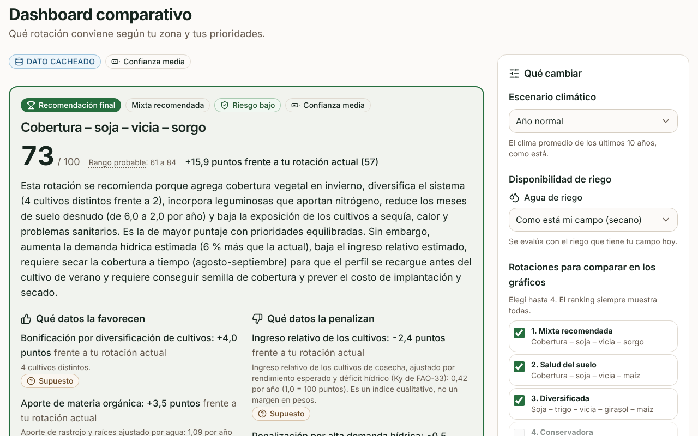

# FieldShift

**Qué sembrar el año que viene, con datos de la NASA, tu suelo y tus prioridades.**

NASA Space Apps Challenge 2026 · desafío **Field Shift: Adapting Farms with NASA Data** · San Luis, Argentina.

**Demo en vivo:** https://proyecto-nasa-space.vercel.app/

## El problema

En el este de San Luis llueven unos 790 mm por año, pero la atmósfera pide más de 1.200 mm. Muchos lotes están en una **zona de
transición**: según el año, se comportan como húmedos o como semiáridos. La rotación de siempre (por ejemplo, soja y maíz con el
suelo desnudo todo el invierno) deja al suelo expuesto y al productor sin margen cuando el año viene seco.

Los datos para decidir mejor existen (satélites y modelos de la NASA), pero están dispersos, en escalas distintas y en un lenguaje técnico.

## Qué hace FieldShift

1. **Diagnostica el lote** con datos de la NASA: clima de 10 años, humedad del suelo, verdor de cada campaña, relieve y calor de la superficie.
2. **Compara tu rotación actual con 6 alternativas** con un puntaje de 0 a 100 que se explica motivo por motivo: agua, suelo, riesgo, ingreso y sostenibilidad.
3. **Lo ajusta a lo que te importa**: movés tus prioridades (ahorrar agua, cuidar el suelo, ingreso) y el ranking cambia al instante.
4. **Prueba escenarios**: año seco, olas de calor, lluvias intensas, más temperatura o riego limitado.
5. **Arma el calendario** campaña por campaña: cuándo sembrar, cuándo el suelo queda desnudo y en qué meses hay riesgo.
6. **Explica qué le hace cada cultivo al suelo**: fija nitrógeno, cubre el suelo, raíz profunda o tolera la sequía.
7. **Avisa** heladas, calor, tormentas y falta de agua de los próximos días, con un **mapa animado de lluvia** de la NASA.
8. Tiene un **modo simple para huertas**, que se ubica por el nombre de la ciudad o pueblo.

Ejemplo real (Campo Este, datos de NASA POWER): la rotación actual saca **57 puntos** y deja el suelo desnudo **6 meses por año**.
La alternativa mixta (cobertura – soja – vicia – sorgo) saca **73 puntos** y baja a **2 meses**, a cambio de un 6 % más de demanda de
agua y de secar la cobertura a tiempo. FieldShift muestra las dos caras.

## Datos de la NASA que usa

| Fuente | Para qué |
|---|---|
| NASA POWER | Clima diario de 10 años: lluvia, calor, heladas y demanda de agua (FAO-56) |
| SMAP | Humedad del suelo en la zona de raíces y en la superficie |
| MODIS NDVI | Verdor por campaña, barbechos y suelo desnudo |
| Landsat/Sentinel (HLS) | Verdor por sectores dentro del lote (30 m) |
| ECOSTRESS | Temperatura de la superficie y estrés hídrico |
| SRTM | Pendiente del lote y riesgo de erosión |
| GPM / IMERG | Mapa animado de la lluvia satelital de las últimas horas |
| GIBS | Imagen satelital del día |

Se combinan con SoilGrids (suelo estimado), los límites del IGN y el pronóstico de Open-Meteo. Cada dato muestra su fuente, su
fecha y si es observado, modelado, estimado o de muestra.

## Honestidad con los datos

- Cada número dice de dónde sale y a qué escala (un dato de 9 km describe la zona, no tu lote).
- Si una fuente no responde se usa la caché y, como último recurso, una **muestra rotulada** como tal.
- Lo que carga el productor (o un análisis de laboratorio) siempre tiene prioridad sobre las estimaciones.
- **No reemplaza a un ingeniero agrónomo**: es una herramienta para pensar opciones y llevarlas a la consulta.

## Más

- Código, cómo correrlo y estado: [fieldshift/README.md](fieldshift/README.md)
- Cómo cumple el desafío: [fieldshift/docs/challenge.md](fieldshift/docs/challenge.md)
- Fuentes y límites: [fieldshift/docs/data_sources.md](fieldshift/docs/data_sources.md)
- Uso de IA: [fieldshift/docs/ai_usage.md](fieldshift/docs/ai_usage.md)
