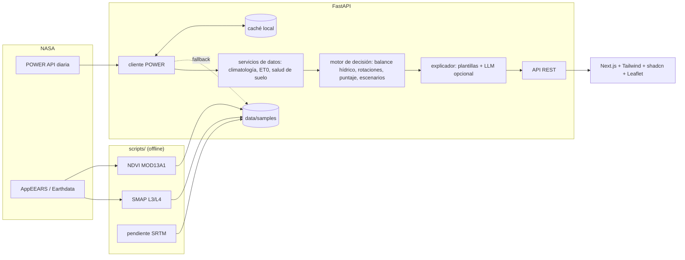

# Arquitectura

## Diagrama

## Flujo de datos

1. NASA POWER se consulta en vivo y pasa por la caché.
2. NDVI, SMAP y SRTM se preprocesan offline con `scripts/` a `data/samples/`.
3. Los servicios de datos calculan climatología, ET₀ y el perfil de salud del suelo.
4. El motor de decisión calcula balance hídrico, puntajes y escenarios.
5. El explicador redacta texto **a partir de resultados ya calculados**.
6. La API entrega todo con procedencia; el frontend solo presenta.

## Capas del backend

| Carpeta | Responsabilidad |
|---|---|
| `api/` | Rutas HTTP finas: validan, llaman a servicios, envuelven la respuesta |
| `services/` | Orquestación y acceso a datos (repositorio, clientes externos) |
| `services/satellite/` | SMAP y MODIS NDVI: parser de CSV de AppEEARS, conector AppEEARS, cascada de respaldo y métricas (ver satellite.md) |
| `services/engine/` | Motor de rotaciones: calendario, balance hídrico, generador, puntaje y explicaciones (ver scoring.md) |
| `models/` | Enums, procedencia (`Provenance`, `Valued`), constantes |
| `schemas/` | Contratos de request y response (Pydantic v2) |
| `utils/` | Validadores, excepciones, handlers de error, logging |
| `data/` | Catálogos JSON editables: cultivos, campos, rotaciones actuales y plantillas de rotación |

La lógica de cálculo (balance hídrico, puntaje) se escribe como funciones puras, sin red ni disco, para poder testearla aislada.

## Procedencia

Todo valor mostrado viaja como `Valued = {value, unit, provenance}`, con `provenance = {label, source_id, retrieved_at, resolution, method, confidence, note}` y `label` en `observado | modelado | estimado | supuesto`.

## Respuestas y errores

- Éxito: `{"data": ..., "meta": {data_status, as_of, warnings, disclaimer}}`.
- `data_status`: `live` (fuente en vivo), `cached` (caché), `sample` (muestra del repo), `mock` (valor simulado, lógica pendiente).
- Error: `{"error": {code, message, details, request_id}}` para validación (422), dominio (400/404), fuente externa (502/503) y errores no controlados (500).

## Fallback y caché

Cascada: **en vivo → caché (cualquier antigüedad, con advertencia) → muestra empaquetada (con advertencia) → 503**.

- Clave de caché: hash de fuente, celda de grilla, parámetros, fechas y versión del parser.
- Datos históricos (hasta hoy − 30 días): no vencen. Recientes: vencen a las 24 h (configurable).
- `scripts/warm_cache` deja todo precargado antes del demo.

## Modelo de datos

| Entidad | Estado |
|---|---|
| Location, Field, SoilProfile, Crop, Rotation, FarmerPriority, Scenario, ClimateSummary, RotationScore, Recommendation, RiskFlag, Assumption, DataSource | Implementadas como schemas |
| Farm | Pendiente (hoy el lote tiene `farm_name`) |
| SoilMoistureSummary (SMAP), VegetationSummary (NDVI), DataTrace | Implementadas (ver satellite.md) |
| RotationPlan (rotación aplicada a un lote con calendario) | Cubierto por `Rotation` + calendario mensual del motor |
| RotationTemplate, RotationProfile, RotationEvaluation, CompareResult | Implementadas (motor de rotaciones) |

## Endpoints

| Método y ruta | Estado |
|---|---|
| `GET /health` | Hecho |
| `GET /crops` | Hecho: 16 cultivos y coberturas |
| `POST /fields`, `GET /fields/{field_id}` | Hecho (en memoria) |
| `POST /priorities` | Hecho (en memoria) |
| `POST /climate-summary` | Hecho: NASA POWER con caché y fallback |
| `POST /rotations/compare`, `GET /rotations/{rotation_id}` | Hecho: motor de rotaciones con puntaje explicable |
| `POST /scenarios` | Hecho: ranking por escenario (lluvia, temperatura, año seco, riego) |
| `GET /export/report` | Hecho: JSON y CSV con ranking, explicaciones, fuentes y supuestos |
| `POST /soil-moisture`, `POST /vegetation-index` | Hecho: AppEEARS asincrónico, CSV o GeoTIFF cargado, caché y muestra |
| `GET /fields` (listar), salud de suelo, alertas | Pendientes |

## Reglas de calidad de datos

- **Coordenadas:** lat en [−90, 90], lon en [−180, 180], sin NaN; se redondean a 4 decimales (la grilla de POWER es de ~50 km). Fuera de San Luis se acepta con aviso.
- **Fechas:** ISO 8601, inicio ≤ fin, no antes del 1981-01-01, no futuras, rango máximo de 20 años.
- **−999 de POWER:** se convierte en nulo y se cuenta por variable y mes; un mes con más de 20 % de faltantes se marca no válido (supuesto).
- **Faltantes:** la lluvia no se interpola; la temperatura se interpola en huecos de hasta 2 días, marcada como estimada.
- **Unidades:** sistema métrico interno; las unidades se leen del metadato de cada respuesta de POWER.
- **Zona horaria:** datos diarios como fecha sin zona; timestamps en UTC; se muestran en `America/Argentina/San_Luis`.
- **Reintentos:** 3, con espera exponencial (1, 2 y 4 s) y componente aleatorio, solo ante 429, 5xx o timeout (30 s).
- **Logs:** JSON con request_id, método, ruta, estado y duración. Nunca claves ni datos del productor.
- **Trazabilidad:** cada valor lleva su procedencia y el reporte exportado incluye fuentes y supuestos.

## Frontend

Next.js (App Router) con TypeScript, Tailwind, componentes al estilo shadcn/ui, Leaflet y Recharts. Habla con la API REST con un cliente tipado a partir del OpenAPI del backend. Cada campo comparte un estado (`CampoProvider`) con sus prioridades y el ranking: al mover una prioridad el total se recalcula en el navegador (Σ peso × valor de cada componente) y se reconcilia con el servidor medio segundo después. Si el servidor no responde, usa datos de ejemplo generados con el propio motor y lo avisa. Detalle en [frontend/README.md](../frontend/README.md).

## Decisiones de stack

- **PostGIS:** fuera de alcance para el hackathon. Persistencia en JSON/Parquet detrás de un repositorio, para poder reemplazarla.
- **geopandas, xarray, rasterio:** solo en `scripts/`, no en el backend.
- **Leaflet** en vez de MapLibre: más simple, sin token, alcanza para puntos.
- **Despliegue:** si se usa la capa gratuita de Render, el primer pedido puede tardar 30–60 s; correr el demo en local o despertar el servidor antes.
