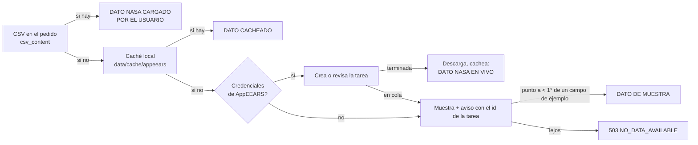

# Humedad de suelo (SMAP) e índice de vegetación (MODIS NDVI)

> FieldShift es una herramienta de apoyo a decisiones. No reemplaza el asesoramiento de un ingeniero agrónomo, análisis de suelo de laboratorio, conocimiento local ni decisiones comerciales del productor.

Código: `backend/app/services/satellite/`. Endpoints: `POST /soil-moisture` y `POST /vegetation-index`.

## 1. SMAP: humedad de suelo

**Qué mide.** SMAP (Soil Moisture Active Passive, NASA, en órbita desde 2015) tiene un radiómetro de microondas en banda L que mide la emisión del suelo. De esa medición se obtiene el contenido volumétrico de agua de los **primeros ~5 cm**, en m³/m³. Para la **zona de raíces** existe un producto de nivel 4: un modelo de superficie terrestre (GEOS-5 Catchment) asimila las observaciones de SMAP y estima la humedad hasta 1 m.

**Qué producto conviene.** Para rotaciones importa el agua que ven las raíces, así que:

| Uso | Producto | Tipo | Resolución | Frecuencia |
|---|---|---|---|---|
| **Zona de raíces (por defecto)** | **SPL4SMGP v8**, capa `sm_rootzone` (0–100 cm) | **Modelado** con asimilación | 9 km (EASE-Grid 2.0) | cada 3 h (se agrega a diario) |
| Superficie, modelada | SPL4SMGP v8, capa `sm_surface` (0–5 cm) | Modelado | 9 km | cada 3 h |
| Superficie, observada | SPL3SMP_E v6 (L3 mejorado, pasada de la mañana) | Observado | 9 km | diaria con huecos (cada 2–3 días) |

La versión 8 de SPL4SMGP es la vigente. AppEEARS la incorporó el 30 de junio de 2025 y dio de baja la versión 7.

**Cómo obtener los datos.**

- **AppEEARS** (recomendado, es lo que implementa FieldShift): pedido de tipo *point* con la latitud y longitud del lote, el producto `SPL4SMGP.008` y la capa `Geophysical_Data_sm_rootzone`. La tarea entra en cola y tarda de minutos a horas; al terminar se descarga un CSV. Requiere una cuenta gratuita de **NASA Earthdata**.
- **NASA Earthdata / NSIDC**: descarga de los archivos HDF5 completos (globales) y extracción propia. Es más pesado y no hace falta para un punto.

**Limitaciones para un lote chico.**

- Un píxel de **9 km** (~8.100 ha) promedia muchos lotes, montes, caminos y bajos: **no es la humedad de tu lote**, es el contexto regional.
- La humedad absoluta depende del suelo del píxel (un arenoso retiene menos que un franco). Por eso FieldShift usa **anomalías y percentiles** frente a la propia serie, no valores absolutos.
- L4 es **modelado**: si el instrumento no observa, el valor sale solo del modelo.
- L3 mide solo ~5 cm: cambia mucho con cada lluvia y no representa el perfil.
- Hay datos desde el 31 de marzo de 2015 (unos 10 años).

## 2. MODIS NDVI: vigor y cobertura vegetal

**Qué es el NDVI.** Es el índice de vegetación de diferencia normalizada: (NIR − Rojo) / (NIR + Rojo). La vegetación verde absorbe el rojo y refleja el infrarrojo cercano. Va de −1 a 1: el suelo desnudo da ~0,1–0,2, un barbecho con rastrojo ~0,2–0,3 y un cultivo en pleno desarrollo 0,7–0,9.

**Qué producto conviene.**

| Producto | Resolución | Frecuencia | Uso |
|---|---|---|---|
| **MOD13Q1 v6.1** (Terra) | **250 m** | compuesto de 16 días | **Por defecto**: la mejor resolución de MODIS |
| MYD13Q1 v6.1 (Aqua) | 250 m | 16 días, desfasado 8 días | Combinado con Terra da un dato cada 8 días |
| MOD13A1 v6.1 | 500 m | 16 días | Alternativa más gruesa |

La versión 6 de MOD13Q1 se dio de baja el 31 de julio de 2023, así que se usa la **6.1**. El NDVI viene como entero: hay que multiplicarlo por 0,0001. El valor de relleno es −3000 y el rango válido, de −2000 a 10000. La capa `pixel_reliability` indica la calidad: 0 = bueno, 1 = marginal, 2 = nieve o hielo, 3 = nubes, −1 = sin dato. Cada compuesto de 16 días se arma eligiendo el mejor valor del período.

**Cómo obtener los datos.** También con **AppEEARS**: pedido *point* con `MOD13Q1.061` y las capas `_250m_16_days_NDVI` y `_250m_16_days_pixel_reliability`, que devuelve un CSV. Para un polígono (todo el lote) se pide un *area* y AppEEARS entrega un GeoTIFF por fecha: `scripts/geotiff_to_csv.py` los convierte al CSV que acepta la API.

**Limitaciones.**

- **250 m** = 6,25 ha por píxel. En lotes de menos de ~25 ha se mezclan vecinos y bordes.
- Los compuestos de 16 días no ven con precisión la fecha de siembra ni de cosecha.
- Nubes, humo o nieve invalidan píxeles: se descartan, y en verano puede haber huecos.
- El NDVI se satura con mucha biomasa (> 0,8) y no distingue un cultivo de las malezas.
- **No mide materia orgánica ni carbono del suelo.** La "salud del suelo" que se infiere es indirecta: cobertura, barbechos y biomasa producida.

## 3. Cómo se obtienen los datos en FieldShift

Hay un enfoque híbrido con cascada de respaldo. El origen siempre queda indicado en `trace.status` y en `meta.origin_label`:

- **Conector para producción** (`appeears.py`): login con Earthdata, `POST /task`, `GET /task/{id}` y descarga del bundle. Como AppEEARS es asincrónico, la primera consulta crea la tarea y responde con la muestra (con aviso). Las siguientes revisan la tarea y, cuando termina, descargan y guardan el CSV.
- **Credenciales:** variables `FIELDSHIFT_APPEEARS_TOKEN` o `FIELDSHIFT_APPEEARS_USERNAME` y `FIELDSHIFT_APPEEARS_PASSWORD` (ver `.env.example`). Nunca se guardan en el código.
- **Carga de CSV:** campo `csv_content` con el CSV de AppEEARS tal como se descarga, o con el formato simple `date,value[,qa]`.
- **Carga de GeoTIFF:** `scripts/geotiff_to_csv.py` (necesita `rasterio`, que no es dependencia del backend).
- **Datos de muestra:** `data/samples/smap_sample_san_luis.csv` y `ndvi_sample_san_luis.csv`, **simulados** con el formato de AppEEARS. Ver la sección 6.

## 4. Métricas

### Humedad de suelo (`POST /soil-moisture`)

| Métrica | Cálculo |
|---|---|
| Humedad promedio | Promedio diario del período (m³/m³), con mínimo y máximo y su fecha |
| Frecuencia de sequías | % de meses con anomalía estandarizada z ≤ −1 frente al mismo mes de los otros años (mínimo 3 años); también se listan los eventos (meses seguidos) |
| Meses con baja humedad | Meses con promedio por debajo del percentil 25 de todos los meses (sequedad absoluta, incluye la estacional); además, los 4 meses del año típicamente más secos |
| Tendencia | Pendiente de Sen + test de Mann-Kendall sobre los promedios anuales (años con 10 meses válidos o más) |
| Estrés hídrico relativo | Promedio de los últimos 90 días frente a la misma época de los otros años: anomalía %, percentil e índice 0–1. **Alto:** percentil ≤ 20 y al menos 10 % por debajo de lo normal. **Medio:** percentil ≤ 40 y al menos 5 % por debajo |

Un mes es válido con al menos 20 días con dato (8 para SMAP L3, que tiene huecos).

### NDVI (`POST /vegetation-index`)

| Métrica | Cálculo |
|---|---|
| NDVI promedio | Promedio de los compuestos válidos (sin nubes, nieve ni relleno) |
| Cobertura vegetal estimada | Modelo de píxel dimidiado (Gutman e Ignatov, 1998): (NDVI − 0,15) / (0,85 − 0,15), limitado a 0–1 |
| Períodos de barbecho | Al menos 2 compuestos seguidos (~1 mes) con NDVI < 0,3 (umbral configurable); fracción de suelo desnudo |
| Tendencia de biomasa | Sen + Mann-Kendall sobre el **NDVI integrado** por campaña (suma de (NDVI − 0,15) × 16 días, proxy de la biomasa producida); también en % por década |
| Comparación entre campañas | Por campaña (julio a junio): NDVI medio y pico, NDVI integrado, cobertura, suelo desnudo, **ciclos de crecimiento** (1 = un cultivo, 2 = doble cultivo o cobertura) y anomalía frente al promedio; mejor y peor campaña |

Se interpola un compuesto faltante aislado (queda marcado como interpolado). Una campaña es completa con al menos 18 de ~23 compuestos válidos.

## 5. Integración con el motor de rotaciones

`POST /rotations/compare` busca solo SMAP y NDVI del lote, con la misma cascada (se puede desactivar con `use_satellite: false` o enviar los valores a mano).

| Dato | Componente | Efecto |
|---|---|---|
| Anomalía reciente de humedad (SMAP) | **A**, resiliencia hídrica | ± hasta 5 puntos × la demanda relativa de la rotación |
| Frecuencia de sequías de suelo (SMAP) | **R**, resiliencia climática | Si supera el ~16 % esperable: hasta −10 puntos, más en rotaciones con cultivos poco tolerantes a sequía |
| Suelo desnudo observado (NDVI) | **S**, salud del suelo (solo la actual) | Si supera lo declarado en 20 puntos porcentuales o más, se aumenta la exposición a erosión de la rotación actual |
| Cobertura observada (NDVI) | S (solo la actual) | Informativa: se muestra junto al puntaje |
| Tendencia de biomasa (NDVI) | S (solo la actual) | −6 si cae de forma significativa; +4 si sube de forma significativa |

El NDVI se aplica solo a la rotación actual porque observa el manejo real del lote: no dice nada de las alternativas. Si SMAP o NDVI vienen de la muestra, la confianza baja y se dice por qué.

## 6. Trazabilidad

Cada respuesta trae un bloque `trace` con:

- **Fuente y producto:** proveedor, producto, versión y capa (por ejemplo `SPL4SMGP.008 · Geophysical_Data_sm_rootzone`), nombre, cita y DOI.
- **Tipo de dato:** observado o modelado.
- **Fechas:** período pedido, última observación y fecha de obtención.
- **Resolución:** espacial y temporal, y profundidad (SMAP).
- **Estado:** `live` (real en vivo), `cached` (cacheado), `uploaded` (CSV cargado) o `sample` (muestra), con su etiqueta visible.
- **Limitaciones** del producto, y el id de la tarea de AppEEARS si se pidió una.
- **Calidad** (`quality`): registros, válidos, faltantes o relleno, descartados por calidad y si se aplicó el factor de escala.

### Datos de muestra (simulados)

Las muestras **no son observaciones**. `scripts/generate_satellite_samples.py` las genera así:

- **SMAP:** balance de agua diario alimentado por la lluvia de la muestra de POWER (también simulada) y una ET₀ de Hargreaves.
- **NDVI:** fenología de la rotación actual declarada de cada campo, con picos que dependen de la lluvia de la campaña, malezas en barbechos lluviosos, nubes (más en verano), datos marginales y faltantes. Campo Centro tiene una caída lenta de biomasa.

Usan el formato de AppEEARS, así que pasan por el mismo parser que los datos reales.

## 7. Pendiente de verificar con datos reales

- **Nombres exactos de las columnas** del CSV de AppEEARS. No pude confirmarlos sin acceso a la API desde este entorno. El parser reconoce la columna por el final del nombre de la capa, así que tolera prefijos distintos, pero conviene grabar una respuesta real como fixture.
- Si AppEEARS entrega el NDVI ya escalado o en enteros: el parser maneja los dos casos.
- La decodificación de la bandera de calidad de SPL3SMP_E en AppEEARS.
- El formato de la respuesta de `/bundle/{task_id}` de AppEEARS.

## Fuentes

- NSIDC, SPL4SMGP v8: <https://nsidc.org/data/spl4smgp>
- NASA Earthdata, "New versions of SMAP Level 4 products now available in AppEEARS" (30/06/2025): <https://www.earthdata.nasa.gov/data/alerts-outages/new-versions-smap-level-4-products-now-available-appeears>
- NSIDC, SPL3SMP_E: <https://nsidc.org/data/SPL3SMP_E>
- NASA Earthdata, MOD13Q1 v061: <https://www.earthdata.nasa.gov/data/catalog/lpcloud-mod13q1-061>
- Google Earth Engine, MODIS/061/MOD13Q1 (escala, relleno y confiabilidad del píxel): <https://developers.google.com/earth-engine/datasets/catalog/MODIS_061_MOD13Q1>
- LP DAAC, introducción al muestreador por punto de AppEEARS: <https://lpdaac.usgs.gov/resources/e-learning/introduction-appeears-point-sampler>
- Gutman, G. e Ignatov, A. (1998). The derivation of the green vegetation fraction from NOAA/AVHRR data for use in numerical weather prediction models. *International Journal of Remote Sensing*, 19(8).
