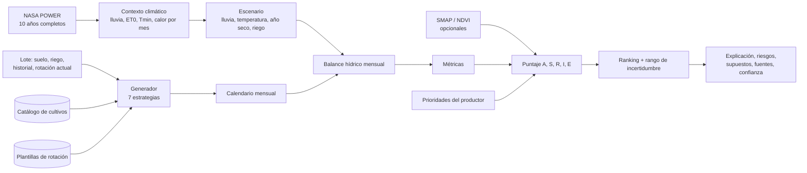

# Motor de rotaciones y puntaje explicable

> FieldShift es una herramienta de apoyo a decisiones. No reemplaza el asesoramiento de un ingeniero agrónomo, análisis de suelo de laboratorio, conocimiento local ni decisiones comerciales del productor.

Código: `backend/app/services/engine/`. Ejemplos de salida: [`examples/`](examples/README.md).

## Flujo



1. **Clima** (`context.py`): se piden a NASA POWER los últimos 10 años completos y se arma la climatología mensual: lluvia, ET₀ FAO-56, Tmin media y frecuencia de días con Tmax > 35 °C. También se guarda el año más seco observado.
2. **Zona** (`parameters.py`): índice de aridez P/ET₀ con las clases de UNEP: árido < 0,2; semiárido < 0,5; subhúmedo seco < 0,65; húmedo. Con riego, las plantillas se eligen como en zona subhúmeda.
3. **Rotaciones** (`generator.py`): actual, conservadora, diversificada, ahorro de agua, salud del suelo, rentabilidad y mixta recomendada.
4. **Calendario** (`calendar.py`): qué cultivo ocupa cada mes del ciclo de 12 × N meses.
5. **Agua** (`water.py`): balance hídrico mensual con Kc, lluvia efectiva, almacenaje en el perfil y riego.
6. **Puntaje** (`scoring.py`): 5 componentes de 0 a 100, cada uno con sus términos explícitos.
7. **Explicación** (`explain.py`): texto, beneficios, riesgos, evidencia separada en 4 fuentes, supuestos e incertidumbres.

El motor (`engine.run`) es una función pura: no usa red ni disco. `service.py` trae el clima y arma el pedido.

## Entradas

| Entrada | De dónde sale | Si falta |
|---|---|---|
| Ubicación | Lote | Obligatoria |
| Resumen climático | NASA POWER (caché → en vivo → caché vencida → muestra) | Error 503 |
| Humedad de suelo SMAP | `soil_moisture` en el pedido (anomalía %, L3 o L4) | No se usa y se avisa |
| NDVI MODIS | `vegetation` en el pedido (fracción de compuestos con NDVI < 0,3) | No se usa y se avisa |
| Perfil de suelo | Lote (textura, profundidad, laboratorio) | Franco arenosa supuesta, con aviso y menos confianza |
| Cultivo actual | `current_crop` o último del historial | Sin ajuste por antecesor |
| Rotación histórica | `history` o `crop_history` del lote | Sin aviso de monocultivo reciente |
| Riego | Lote o escenario con `irrigation: true` | Secano |
| Prioridades | Pedido, guardadas o por defecto (5 en todo) | Pesos iguales, con aviso |
| Escenario | `scenario` (lluvia −50 a +30 %, +0 a +3 °C, año seco) | Clima del período |

SMAP y NDVI todavía no se descargan solos: el preprocesamiento offline está pendiente (fase 3). Hasta entonces se pasan en el pedido.

## Generador de rotaciones

| Estrategia | Cómo se arma |
|---|---|
| Actual | La declarada del lote o, si no hay, las últimas 3 campañas del historial con fechas típicas |
| Conservadora | La actual con cambios mínimos por reglas (abajo) |
| Diversificada | Plantilla con 5 cultivos de 3 familias |
| Ahorro de agua | Plantilla con cultivos de baja demanda y barbechos para acumular agua |
| Salud del suelo | Plantilla con coberturas en invierno o pastura perenne |
| Rentabilidad | Plantilla con los cultivos de mayor ingreso relativo |
| Mixta recomendada | Se evalúan las 3 variantes mixtas de la zona y se queda la de mayor puntaje **con las prioridades del productor** |

Las plantillas están en `backend/app/data/rotation_templates.json`. Cada una indica para qué zonas (`semiarido`, `subhumedo`) y para qué condición de riego vale. Para cada estrategia se usa la primera que coincide. Se pueden editar sin tocar código: `test_catalog.py` verifica que no haya cultivos superpuestos, que las siembras caigan en época y que los ciclos tengan el largo correcto.

**Reglas de la conservadora**, en orden:

- **C1-agua**: en secano semiárido, maíz → sorgo.
- **C2-monocultivo**: si un cultivo anual se repite en campañas seguidas, se alterna con otro de distinta familia que no lo tenga como antecesor a evitar.
- **C3-cobertura**: cobertura de gramíneas de abril a agosto en el primer invierno libre. Se aplica en zona subhúmeda o con riego; en semiárido, solo si no se aplicó otra regla.

Si dos estrategias producen la misma rotación, se muestra una sola vez, con aviso. Siempre hay al menos 3 rotaciones y la actual está incluida; si no, la API responde 400.

## Balance hídrico mensual

Para cada mes del ciclo, simulado dos veces para que el resultado no dependa del agua inicial:

- **Con cultivo:** la demanda es Kc × ET₀ del mes. Se cubre primero con la lluvia efectiva, después con el agua almacenada; lo que falta es el déficit. Con riego se cubre el 80 % del déficit. La mitad de la lluvia efectiva que no se usa pasa al perfil.
- **En barbecho:** se almacena `eficiencia de barbecho × lluvia` (0,15 a 0,25 según textura).
- **Tope de almacenaje:** agua útil = (mm/m de FAO-56 Tabla 19 según textura) × profundidad de raíces (1 m por defecto).

| Elemento | Fórmula o valor | Fuente |
|---|---|---|
| Kc mensual | 1.er mes inicial; 2.º mes promedio inicial–medio (si el ciclo dura 4 meses o más); centrales medio; último final | FAO-56 Tabla 12; coberturas: supuesto |
| Lluvia efectiva | P ≤ 250 mm: P(125 − 0,2P)/125; P > 250: 125 + 0,1P | USDA-SCS (FAO CROPWAT) |
| Agua útil | arenosa 80, franco arenosa 130, franca 155, franco limosa 160, franco arcillosa 155, arcillosa 160 mm/m | FAO-56 Tabla 19 (punto medio) |

Salidas: demanda (mm/año), cobertura de la demanda (%), déficit antes del riego, riego estimado y estrés relativo por mes y por cultivo.

## Componentes del puntaje

Cada componente se limita al rango de 0 a 100. Cada término aparece en la respuesta como `ScoreDriver`, con sus puntos, el motivo y la procedencia.

### A — Resiliencia hídrica

| Término | Puntos |
|---|---|
| Demanda cubierta | 100 × fracción de la demanda cubierta por lluvia efectiva + agua almacenada (+ riego, si hay) |
| **Penalización por alta demanda hídrica** | −40 × (demanda/lluvia − 0,8), máximo −40 |
| **Ajuste por riego** | −(riego mm/año)/40, máximo −15: el riego cubre el déficit (suma en el primer término), pero el agua tiene costo y presiona el acuífero |
| Tolerancia a sequía | +6 × promedio de tolerancia (bajo 0, medio 0,5, alto 1), ponderado por meses |
| Humedad SMAP (opcional) | ± anomalía/5 (máximo ±5) × (demanda/lluvia entre 0,5 y 1,2) |

### S — Salud del suelo

| Término | Puntos |
|---|---|
| **Bonificación por cobertura vegetal** | +40 × meses con cultivo vivo / meses del ciclo, ponderando cada mes por (1 − 0,5 × déficit del mes): una cobertura sin agua produce menos biomasa |
| Aporte de materia orgánica | +30 × min(1, aporte anual / 1,2); aporte de cada cultivo: bajo 0, medio 0,5, alto 1, por (1 − 0,5 × su déficit) |
| **Bonificación por leguminosas** | +15 × min(1, leguminosas por año / 0,5) |
| Diversidad de raíces | +7,5 por cada profundidad de raíz adicional (máximo +15) |
| **Penalización por erosión** | −3 × exposición × erodabilidad de la textura × factor de pendiente, máximo −40 |

Exposición a erosión: suma anual de los meses de barbecho. Cada mes pesa según el rastrojo del cultivo anterior (riesgo de erosión bajo 0,4; medio 0,7; alto 1,0) y × 1,3 si cae en la época ventosa (julio a noviembre). Erodabilidad eólica: arenosa 1,0 … arcillosa 0,4. Pendiente (SRTM): factor 1 + pendiente/10, máximo 1,5. Si el NDVI muestra más suelo desnudo que lo declarado (+15 puntos porcentuales o más), se escala la exposición de la rotación actual.

### R — Resiliencia climática

Parte de 100 y descuenta:

| Término | Puntos |
|---|---|
| Exposición a sequía | −60 × promedio, en los meses con cultivo, de (déficit del mes × sensibilidad a sequía × factor de variabilidad) |
| Exposición a calor | −30 × promedio de (frecuencia de días con Tmax > 35 °C / 0,3 × sensibilidad al calor) |
| Exposición a heladas | −15 × promedio de (1 si Tmin media ≤ 3 °C; 0,5 si ≤ 6 °C) × sensibilidad a heladas |
| **Penalización por monocultivo** | −10 × factor sanitario (riesgo de plagas bajo 0,6; medio 1; alto 1,5) por cada repetición seguida de un cultivo anual, máximo −30 |
| Intervalo de retorno corto | −6 por cultivo que vuelve antes de lo recomendado en el catálogo, máximo −18 |
| Antecesores desfavorables | −5 por cada uno (por ejemplo, maní después de soja), máximo −15 |
| Antecesores favorables | +2 por cada uno, máximo +6 |
| Inicio sobre el cultivo actual | −5 si el primer cultivo tiene al actual como antecesor a evitar; −8 si además se repitió en el historial |

Sensibilidad según la tolerancia del catálogo: baja 1,0; media 0,6; alta 0,3. Factor de variabilidad: 1 + max(0, CV de la lluvia − 15 %)/50.

### I — Ingreso relativo estimado

**No usa precios ni costos.** Es un índice cualitativo.

```
valor de cada cultivo = ingreso relativo (bajo 0,35; medio 0,65; alto 1,0)
                        × rendimiento relativo en San Luis (bajo 0,6; medio 0,85; alto 1,0)
                        × max(0, 1 − Ky × déficit relativo)           ← FAO-33
                        × 0,85 si el mercado local es bajo
cada cobertura sin cosecha resta 0,08
I = 100 × min(1, suma por año / 1,0)
```

Ky (FAO-33): maíz 1,25; trigo 1,05; girasol 0,95; sorgo 0,9; soja 0,85; maní 0,7; alfalfa 1,1. Las especies que FAO-33 no lista toman el Ky de una similar (supuesto).

### E — Sostenibilidad y diversificación

| Término | Puntos |
|---|---|
| Base | 20 |
| **Bonificación por diversificación** | +10 por cada cultivo distinto después del primero, máximo +30 |
| Familias botánicas | +10 por cada familia después de la primera, máximo +20 |
| **Bonificación por leguminosas** | +15 × min(1, leguminosas por año / 0,5) |
| Coberturas y pasturas | +15 × min(1, fracción de meses con cobertura o pastura / 0,4) |
| **Penalización por monocultivo** | −15 por repetición, máximo −30 |

## Total, pesos e incertidumbre

```
Score = w_agua·A + w_suelo·S + w_riesgo·R + w_ingreso·I + w_sostenibilidad·E
w_k = prioridad_k / suma de prioridades       (prioridades de 0 a 10; todas en 0 = pesos iguales)
```

- **Rango de incertidumbre:** se recalcula el total con lluvia −15 % y ET₀ +5 %, y con lluvia +15 % y ET₀ −5 %. Al mínimo y al máximo se les suma un margen según la confianza (alta ±2, media ±5, baja ±8).
- **Confianza:** baja si el clima es la muestra simulada o si hay 4 o más motivos; media con 1 a 3 motivos; alta sin motivos. Los motivos son: menos de 8 años de clima, textura supuesta, sin análisis de laboratorio, cultivos con confianza baja en el catálogo, y sin SMAP ni NDVI.
- **Nivel de riesgo:** según R: 70 o más bajo, 45 a 70 medio, menos de 45 alto.

## Escenarios

| Parámetro | Efecto |
|---|---|
| `rain_delta_pct` | Lluvia mensual × (1 + Δ/100) |
| `temp_delta_c` | ET₀ × (1 + 0,03 × ΔT); Tmin + ΔT; frecuencia de calor desplazada como una normal con desvío de 5 °C |
| `dry_year` | Usa la lluvia y la ET₀ mensuales del año completo más seco observado |
| `irrigation` | Evalúa el lote como si tuviera riego |

Las rotaciones son las mismas en todos los escenarios: cambia el puntaje, no la lista. Así se pueden comparar. Los escenarios son pruebas de sensibilidad, no proyecciones climáticas.

## Explicabilidad

Cada rotación trae:

- `recommendation.why`: un párrafo en lenguaje simple. La recomendada empieza con "Esta rotación se recomienda porque…", las demás se comparan con la actual y con la primera, y la actual se presenta como línea base. Las ventajas y desventajas salen de comparar métricas con la rotación actual: demanda hídrica, meses cubiertos en invierno, cultivos distintos, monocultivo, leguminosas, meses de suelo desnudo, riesgo e ingreso. A eso se suman los requisitos de manejo de la plantilla y los cultivos nuevos con mercado local bajo.
- `profile`: secuencia, duración, beneficios, riesgos, demanda de agua, impacto en suelo, erosión y biodiversidad, ingreso relativo, complejidad y justificación.
- `score.components[].drivers`: cada bonificación y penalización con sus puntos.
- `recommendation.evidence`: separada en datos NASA, suelo local, productor y lo que requiere validación.
- `recommendation.assumptions`, `uncertainties`, `information_gaps`, `validation_note` y `disclaimer`: siempre presentes. `test_engine.py` lo verifica para todas las rotaciones.
- `risk_flags`: cada uno con ícono y texto; la severidad nunca se comunica solo con color.

## Catálogo de cultivos

`backend/app/data/crops.json`: 16 cultivos y coberturas, editables. Atributos cualitativos (bajo / medio / alto) y rangos: ciclo en meses, época de siembra, años mínimos antes de repetir. Los únicos valores numéricos puntuales son Kc (FAO-56) y Ky (FAO-33), cada uno con su fuente en `kc_source` y `ky_source`. El resto está marcado con su fuente y su nivel de confianza, y **debe validarse con INTA y agrónomos locales**.

Para agregar un cultivo, sumá una entrada con todos los campos. El repositorio verifica al arrancar que todos los antecesores, plantillas, rotaciones e historiales nombren cultivos existentes, y `test_catalog.py` verifica la coherencia.

## Limitaciones conocidas

- **Clima regional:** NASA POWER describe ~50 km. La lluvia del lote puede ser distinta.
- **Paso mensual:** no ve sequías de pocas semanas en períodos críticos como la floración.
- **Kc estándar:** no considera variedades, densidad ni fecha de siembra exacta.
- **Pasturas perennes:** se modelan con Kc de pastura bien regada todo el año, así que en secano semiárido se sobrestima su demanda y se subestima su resiliencia (en la realidad entran en latencia).
- **Ingreso:** índice relativo. No hay precios, costos, fletes ni impuestos.
- **Erosión:** no hay datos de viento por lote ni de rugosidad; la época ventosa es un supuesto.
- **Atributos del catálogo:** cualitativos y provisorios.
